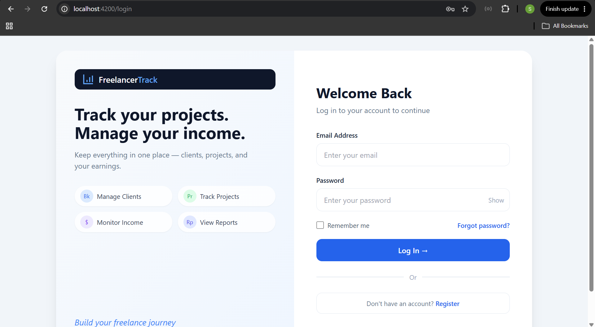
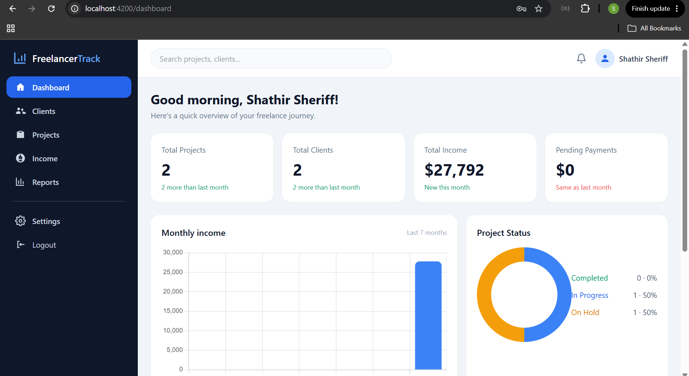
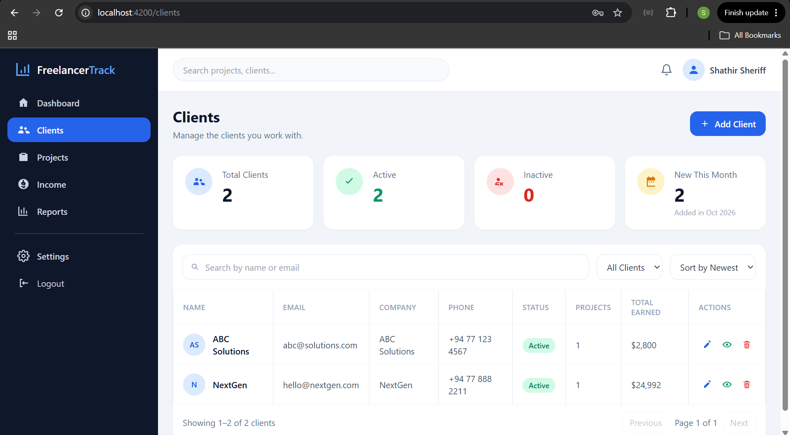
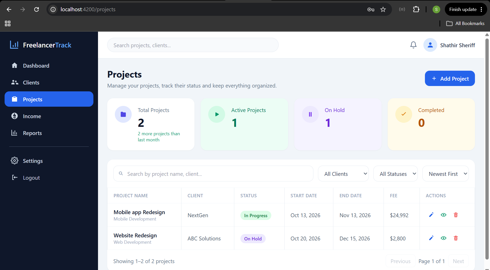
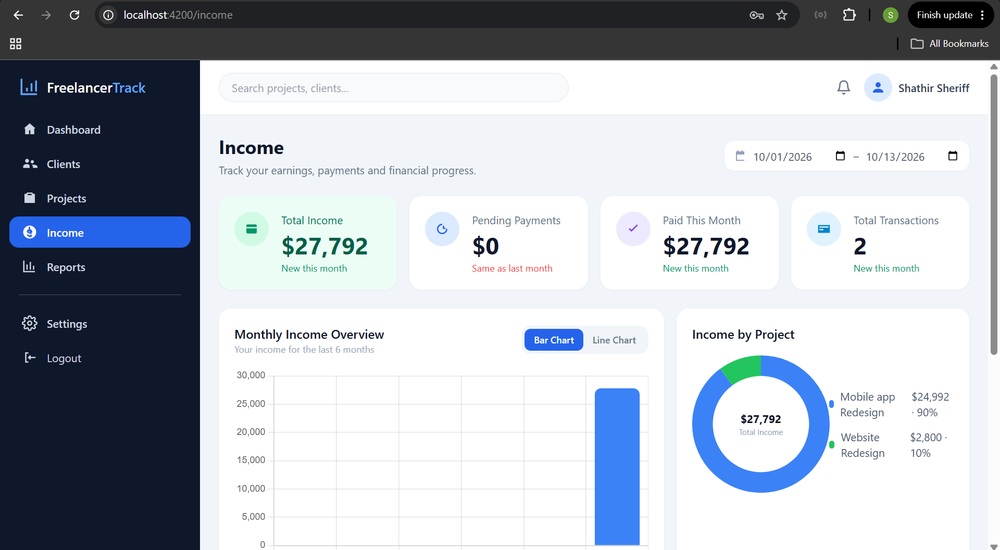
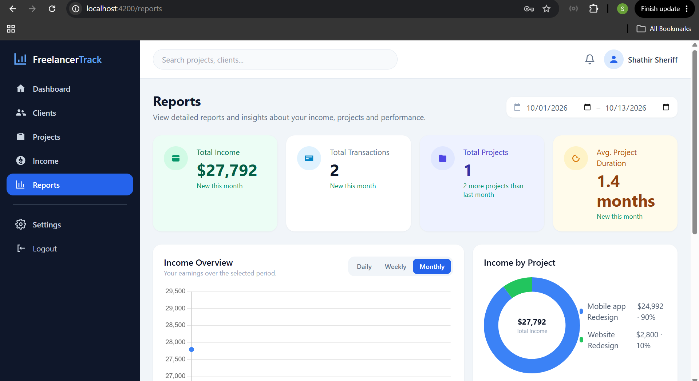

# Freelancer Project & Income Tracker

A full-stack app for one freelancer to register, sign in, and manage clients, projects, and income. The signed-in freelancer owns every record. Clients and projects are data, not separate login accounts.

This repository is an individual submission for Software Engineering Team 405.

## Technologies

| Area | Choice |
|------|--------|
| Frontend | Angular 21, TypeScript, Tailwind CSS 3 |
| Charts | Chart.js with ng2-charts 10 |
| Backend | Node.js, Express 5, TypeScript |
| Database | MongoDB with Mongoose |
| Security | JWT authentication and bcrypt password hashing |
| Version control | Git and GitHub |

## Features

### User registration and login

A freelancer registers and signs in with email and password. The password is hashed with bcrypt, and a JWT protects the API and the signed-in pages. The login form checks the email and password and shows an error when they are wrong.




### Dashboard

The dashboard shows the signed-in freelancer’s project count, client count, total paid income, and pending payments. It also shows a monthly income bar chart and a project status chart.




### Clients

Clients can be added, edited, viewed, and deleted. The page searches by name or email, filters by status, sorts the list, and pages the results.




### Projects

Each project stores a name, client, status, and fee. The page searches by project or client, filters by client and status, and pages the results.




### Income and payments

Income records store an amount, a Paid or Pending status, a project, and a date. The page filters by status, client, and date range, and charts monthly income and income by project. CSV and PDF export are available from this page.




### Reports

Reports summarize income and projects for a chosen date range, with daily, weekly, and monthly charts, plus CSV and PDF export.




### Also included

- Form checks and API error messages on create, update, login, and registration.
- A layout that stacks on a narrow screen and uses a sidebar on a wide screen.
- Settings for profile, password, notification switches, language, and a light or dark theme.
- Notifications when a project status changes or a payment is marked Paid, opened from the navbar bell.
- Navbar search for client name, client email, project name, or project client.

## Project layout

```text
backend/          Express API
frontend/         Angular app
documentation/    Notes for each feature
```

The API is mounted at `http://localhost:5000`. Signed-in routes include `/api/auth`, `/api/clients`, `/api/projects`, `/api/income`, and `/api/notifications`.

## Setup

Install [Node.js](https://nodejs.org/) 20 or newer, npm, and [MongoDB](https://www.mongodb.com/) running on this machine.

1. Clone the repository and open the project folder.
2. In `backend`, install dependencies and create the environment file:

```bash
cd backend
npm install
copy .env.example .env
```

On macOS or Linux, use `cp .env.example .env` instead of `copy`.

3. Open `backend/.env` and set a long random `JWT_SECRET`. The sample file uses:

```text
PORT=5000
MONGODB_URI=mongodb://127.0.0.1:27017/freelancer_tracker
JWT_SECRET=change_this_to_a_long_random_string
```

4. Start MongoDB, then start the API:

```bash
npm run dev
```

The API listens on `http://localhost:5000`. `GET /api/health` returns a status message when it is running.

5. In a second terminal, install the Angular app and start it with `ng serve`:

```bash
cd frontend
npm install
ng serve
```

Use `ng serve` in `frontend`. `npm start` does not start this app.

6. Open `http://localhost:4200`, register an account, and sign in.

The Angular app stores the JWT in the browser under the key `token` and sends it as `Authorization: Bearer <token>` on later API calls.

## Feature notes

Shorter notes for each area live in `documentation/`:

- `user-authentication.md`
- `dashboard.md`
- `clients.md`
- `projects.md`
- `income.md`
- `reports.md`
- `settings.md`
- `notifications.md`
- `navbar.md`
- `sidebar.md`
